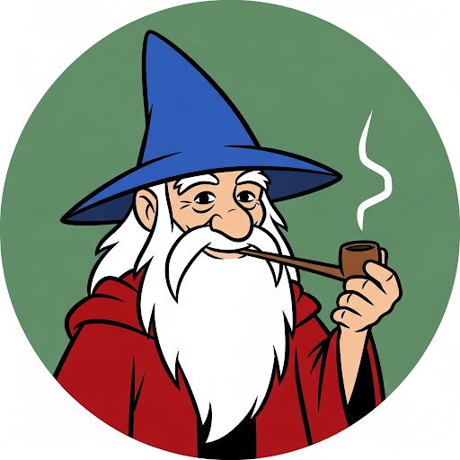

# jbot
A daily bot for group trivia questions and competition.



## Setup

1.  Ensure you are running **Python 3.14** or later.
2.  Install the required Python packages:
    ```
    pip install -r requirements.txt
    ```
2.  Create a `.env` file in the root directory by copying the `.env.template` file. Fill out the required fields, such as your Discord bot token.
3.  Configure your question sources in `sources.toml`. This file defines which datasets to use, their weights for selection, and dataset-specific settings. See the comments in `sources.toml` for examples.
4.  The database will be created automatically when you run the bot for the first time.

## Running the Bot

Once the setup is complete, you can run the bot with the following command:

```
python run.py
```

## Running with Docker (Recommended)

You can also run the bot using Docker, which simplifies dependency management.

1.  **Build and Start**:
    ```bash
    docker compose up -d
    ```
    This command will build the image and start the container in the background. It automatically loads your `.env` file and persists the `jbot.db` database.

2.  **Manage**:
    *   **Stop**: `docker compose stop`
    *   **View Logs**: `docker compose logs -f`
    *   **Rebuild**: `docker compose up -d --build` (Run this after changing code or requirements)

## Deploying to Railway

The bot is deployed to [Railway](https://railway.app) with GitHub auto-deploys. The database is persisted on a Railway volume and continuously replicated to a Railway Bucket via [Litestream](https://litestream.io/).

### Architecture

- **Code**: Railway builds the Docker image from the `main` branch on each push.
- **Database**: Stored on a Railway volume at `/data/jbot.db`. On startup, `entrypoint.sh` uses an existing local DB as-is; otherwise it restores the latest replica from the bucket, and refuses to start an empty database if the bucket cannot be reached (see Bootstrapping below). On shutdown/crash, Litestream has already been streaming WAL changes continuously. There is no separate nightly backup; Litestream replication is the backup.
- **Datasets**: `entrypoint.sh` runs `scripts/sync_datasets.py`; when S3 settings are configured, missing files are downloaded into `JBOT_DATASETS_DIR/datasets/`. Existing local files are skipped. Local development still requires manually downloaded datasets; see [Datasets](#datasets).
- **Replication**: Litestream streams WAL changes to a Railway Bucket (S3-compatible) in real time.

### Initial Setup

1. **Create a Railway project** and connect your GitHub repo.
2. **Add a Railway Bucket** to your project. Note the bucket name and endpoint from its Variables tab.
3. **Add a Volume** to your bot service (Settings → Volumes), mounted at `/data`.
4. **Set environment variables** in the service's Variables tab. Copy all keys from `.env.template` and set values appropriately, plus these additional Railway-specific vars:

| Variable | Value |
|---|---|
| `JBOT_DB_PATH` | `/data/jbot.db` |
| `JBOT_DATASETS_DIR` | `/app` |
| `LITESTREAM_ACCESS_KEY_ID` | From the Railway Bucket's Variables tab |
| `LITESTREAM_SECRET_ACCESS_KEY` | From the Railway Bucket's Variables tab |
| `LITESTREAM_BUCKET` | Bucket name (from Railway Bucket's Variables tab) |
| `LITESTREAM_ENDPOINT` | Bucket endpoint URL (from Railway Bucket's Variables tab) |

### Bootstrapping the Database

On startup, `entrypoint.sh` decides what to do with the database:

1. If a local DB exists at `JBOT_DB_PATH`, it is used as-is. S3 is not contacted, so a bucket outage does not stop the bot.
2. Otherwise it asks Litestream for the replica's history (`litestream ltx`). If S3 cannot be reached, it retries 3 times, 30 seconds apart, then **exits without starting**. A bucket outage therefore never creates an empty database.
3. If the replica has history, it is restored.
4. If the replica is confirmed empty, the bot starts a new database (seeded from `/app/db/jbot.db` only if that file is in the image, which the `.dockerignore` `**/*.db` rule normally prevents).

Litestream replicates from whichever database was started.

**Bootstrapping a new deployment:** upload your local database to the bucket before the first deploy, using an S3-compatible tool (e.g. `boto3`, `awscli` pointed at `LITESTREAM_ENDPOINT`). Startup then restores from the bucket.

**Setting `JBOT_ALLOW_EMPTY_START=1`** skips the replica check and starts an empty database. Litestream will replicate that empty database over any existing S3 history. Use it only when you deliberately want to replace remote history.

**If you need to re-bootstrap** (e.g. the volume was wiped or the bucket has a corrupt/empty replica):

1. Delete the file from the volume:
    ```bash
    railway ssh
    rm /data/jbot.db
    exit
    ```
2. Delete all objects from the bucket (via Railway UI or AWS CLI pointing at the bucket endpoint).
3. Redeploy — the seed logic will run again.

### Ongoing Management

- **View logs**: `railway logs`
- **SSH into container**: `railway ssh`
- Railway auto-deploys on push to `main`.

## Daily format

Every day, one trivia question is messaged to the group in the morning, and the answer
in the evening. Players must submit their guess and any actions to the game bot before
the answer is revealed.

There are several settings and game modes that control scoring, player actions, and
question selection.

## Game Features

### Power-ups

*   **Jinx**: Target another player to block their streak bonus for the day. The attacker is silenced until the hint is revealed.
    *   **Command**: `/power jinx <player>`
*   **Steal**: Target another player to steal their try/speed bonuses. Costs the attacker streak days.
    *   **Command**: `/power steal <player>`
*   **Rest**: Skip today's question while freezing your streak. Earn a score multiplier on your next correct answer.
    *   **Command**: `/power rest`

Power-ups can be queued overnight before the daily question is posted. Jinx and steal can also be used retroactively against players who have already answered.

### Scoring Bonuses

*   **Answer Streak**: Earn bonus points for each consecutive day answered correctly. Streaks are a resource — they feed into the streak bonus and are the cost of using `/power steal`.
*   **First Try**: Bonus points for getting the answer right on your first guess.
*   **Fastest Answer**: Bonus points for being among the first players to answer correctly.
*   **Before Hint**: Bonus points for answering correctly before the daily hint is revealed.

### Seasons

Monthly seasons reset scores and track standings independently. The top players at the end of each season earn trophies. Seasons can be enabled or disabled via the `JBOT_ENABLE_SEASONS` flag in `.env`.

## Commands

*   **`/answer`**: Submit your answer to the daily question.
*   **`/game status`**: Check the current game status, next event time, and active question.
*   **`/game leaderboard`**: View the score leaderboard (season or all-time).
*   **`/game profile`**: View your player stats and history.
*   **`/power`**: Use a power-up (jinx, steal, rest).

## Database

The bot uses a SQLite database (`jbot.db`) to store all persistent data, including:
*   Questions and answers
*   Player information
*   Daily guesses
*   Message logs

The database schema is defined in `db/schema.sql`. When the bot is run for the first time, it will create the database file in the root directory.

## Datasets

You'll have to download these yourself and update their paths in `sources.toml`. Some assembly required. No guarantees on licensing, etc.

The `sources.toml` file in the root directory controls:
- Dataset file paths (in the `[datasets]` section)
- Question sources and their selection weights (in `[[source]]` entries)
- Dataset-specific settings (like Jeopardy score substitution)
- AI-generated riddle sources via Gemini

Gemini uses `GEMINI_MODEL` and `GEMINI_FALLBACK_MODEL` from `.env` (or Railway
environment variables). The fallback is attempted immediately if the primary
model returns 404, or after retries for other failures; leave the fallback
value empty to disable it. See [Google's model list](https://ai.google.dev/gemini-api/docs/models)
and verify your account has access when choosing models. Updating `.env.template`
does not update existing `.env` files or Railway variables. If hint generation
fails and the source has no hint, the reminder is sent without one.

### Jeopardy!

[Download](https://github.com/jwolle1/jeopardy_clue_dataset) the Jeopardy question bank.

### Synthetic riddles (with hints)

Download [this generated riddle dataset](https://www.kaggle.com/datasets/prajwaldongre/riddles-a-synthetic-riddle-dataset-for-nlp) from Kaggle.

### Knowledge Bowl

Knowledge Bowl offers a dataset here (last accessed 2025-08-10): https://www.kbpractice.com/complete_online_list

### Random dataset

I found [this dataset on Reddit](https://www.reddit.com/r/trivia/comments/3wzpvt/free_database_of_50000_trivia_questions/) containing some questions from *Who Wants to Be a Millionaire*, *Are You Smarter Than a Fifth Grader?*, and some other random questions. Some cleanup/formatting required.

## AI Assistant

This project is being developed with the assistance of an AI programming partner named Lex. Lex's role is to help with coding, suggest improvements, and automate tasks to accelerate development. For more details on Lex's directives and operating procedures, see `.github/copilot-instructions.md`.

## License

This project is licensed under the MIT License. See the [LICENSE](LICENSE) file for details.
